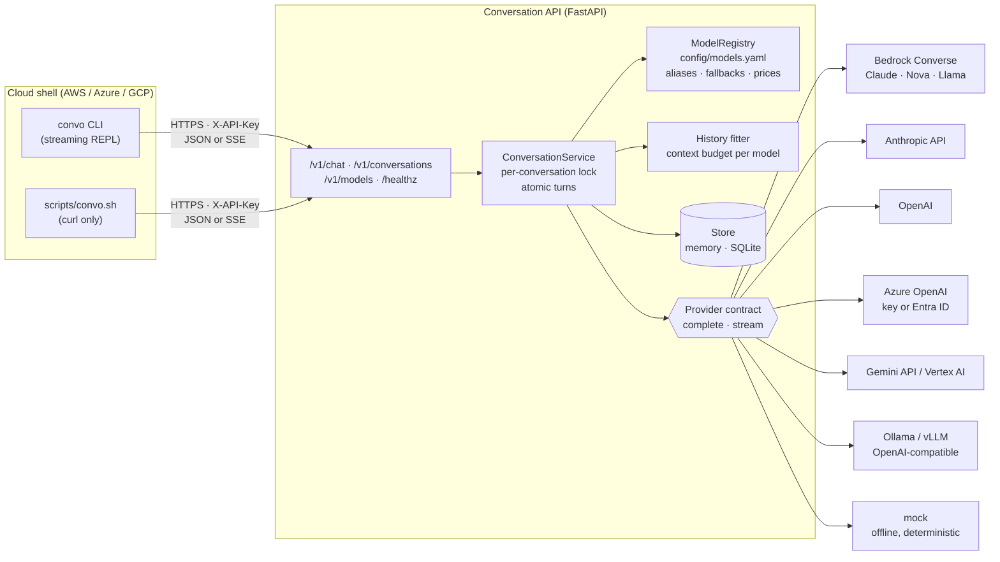

# Conversation API

**A multi-turn conversation API where the model is a config value, not a code dependency.**
One HTTP contract in front of **Amazon Bedrock, Anthropic, OpenAI, Azure OpenAI, Gemini (API or Vertex AI)
and Ollama**. You can swap the model **for one turn, for one conversation, or for every caller at once**,
and the conversation history carries over. It is built to be called from **AWS CloudShell, Azure Cloud Shell
or Google Cloud Shell** with nothing more than `curl`.

> © 2026 Tanmay Roy · Proprietary, view-only (see [LICENSE](LICENSE)).

<sub>Illustrative session:</sub>

```text
$ convo ask "Summarise the CAP theorem in two lines" -m smart
Consistency, availability and partition tolerance: when the network partitions, a distributed system
must give up either consistency or availability...
— claude-sonnet (bedrock:global.anthropic.claude-sonnet-5-5) · 31→58 tok · 1.4s
conversation: conv_3f9c…   (continue: convo say conv_3f9c… "...")

$ convo swap conv_3f9c… azure-gpt          # same conversation, different vendor
$ convo say conv_3f9c… "Now give a real-world example"
— azure-gpt (azure_openai:gpt-4o-mini) · 104→77 tok · 0.9s
```

---

## Architecture



### Three ways to swap a model

| Scope | How | Typical use |
|---|---|---|
| **One turn** | `"model": "fast"` on `POST /v1/conversations/{id}/messages` | a cheap model for a quick follow-up |
| **One conversation** | `PATCH /v1/conversations/{id} {"model": "gpt"}` (or `/model gpt` in the REPL) | user switches model; history is kept and the swap is logged in `model_history` |
| **Every caller** | re-point an alias in [`config/models.yaml`](config/models.yaml) (`smart: claude-sonnet` → `smart: gemini-vertex`) | vendor migration, cost change, outage, A/B; clients never change |

Names resolve as **alias → catalog entry → ad-hoc `provider:model-id`** (for example
`bedrock:us.meta.llama3-3-70b-instruct-v1:0`; can be turned off with `CONVO_ALLOW_ADHOC_MODELS=false`).

### Model IDs from AWS Parameter Store

Any catalog value can be read from **Systems Manager Parameter Store** by writing `ssm:/parameter/name`
instead of the value, either in `config/models.yaml` or through the environment variable that value already
reads. The model ID then lives in AWS, where it can be changed without touching the repo or the server:

```bash
aws ssm put-parameter --name /conversation-api/models/sonnet --type String \
  --value arn:aws:bedrock:us-east-1:111122223333:application-inference-profile/abc123 --overwrite

export BEDROCK_SONNET_ID=ssm:/conversation-api/models/sonnet   # used by claude-sonnet (alias smart)
convo serve                       # resolves the parameter at startup; fails fast if it can't read it
convo models                      # └ model ID from ssm:/conversation-api/models/sonnet

aws ssm put-parameter --name /conversation-api/models/sonnet --type String \
  --value global.anthropic.claude-sonnet-5-5 --overwrite
convo reload                      # claude-sonnet: bedrock:arn:…/abc123 → bedrock:global.anthropic.claude-sonnet-5-5
```

- Works for plain IDs, inference profile ARNs and provisioned-throughput / custom model ARNs; `String` and
  `SecureString` (decrypted) parameters; and parameter ARNs (`ssm:arn:aws:ssm:<region>:…`, read in that region).
  Otherwise the region is `CONVO_SSM_REGION`, then `AWS_REGION`.
- `convo reload` (`POST /v1/admin/reload-models`) or `CONVO_CATALOG_REFRESH_S=300` re-reads the catalog and
  parameters while serving. Existing conversations move to the new ID on their next turn. If a reload
  fails (parameter deleted, access denied), the previous catalog keeps serving and the error is returned.
- IAM: `ssm:GetParameter` on the parameter, plus `kms:Decrypt` for a SecureString with a customer-managed key.
- `CONVO_DEFAULT_MODEL=ssm:/…` works too, to choose the default model name from Parameter Store.

### Fine-tuning data for Amazon Nova

The conversations the API stores can be exported as **Amazon Nova fine-tuning JSONL**
(`bedrock-conversation-2024`, for Nova Micro / Lite / Pro on Bedrock), checked against Nova's rules, and
sent to a Bedrock fine-tuning job:

```bash
export CONVO_STORE=sqlite                               # keep conversations across restarts while you collect
convo collect prompts.txt -m nova-pro --dataset support # one prompt per line, or JSONL {prompt, system, followups}
convo export --where dataset=support --out data/support # train.jsonl + validation.jsonl, with a report
convo validate-jsonl data/support/train.jsonl --validation data/support/validation.jsonl
bash scripts/bedrock_finetune_nova.sh data/support/train.jsonl data/support/validation.jsonl
bash scripts/bedrock_finetune_nova.sh status convo-nova-<timestamp>
```

```json
{"schemaVersion":"bedrock-conversation-2024","system":[{"text":"Be concise."}],
 "messages":[{"role":"user","content":[{"text":"I want a refund"}]},
             {"role":"assistant","content":[{"text":"…"}]}]}
```

| Step | What is enforced or done |
|---|---|
| Nova's rules | first message `user`, last `assistant`, roles alternate, non-empty text; 8–20,000 training samples (warns under 100); 32,000 max content length; the reserved keywords `User:` `Bot:` `Assistant:` `System:` `<image>` `<video>` `[EOS]` in user/system text are rewritten (`User -`) or, with `--drop-reserved`, the sample is dropped |
| Selection | `--where dataset=…` (metadata), `--model` (only replies from given catalog names / model IDs, so swapped or fallback replies can be excluded), `--since`, `--min-turns`; conversations created with `metadata: {"training": false}` are never exported |
| Cleaning | dedup; emails, AWS access key IDs and card numbers redacted by default (`--no-redact` to keep) |
| Shape | `--mode conversation` (one sample per conversation) or `--mode turns` (one per reply, with its history) |
| Split | deterministic train/validation split by `--seed`; never takes the training set below 8 |
| Job | `scripts/bedrock_finetune_nova.sh`: checks the base model is fine-tunable in the region, private S3 bucket (public access blocked), an IAM service role trusted only for this account's customization jobs with access to that bucket, then `create-model-customization-job` (epochs, learning rate, warmup from AWS's samples/640·160·320 guidance). `DRY_RUN=1` prints the command. The output tells you how to deploy the custom model on demand and point the API at it (`-m bedrock:<deployment-arn>` or an `ssm:` parameter). |

A ready-made dataset to try the job with: [`examples/datasets/ai-ml-tutor`](examples/datasets/ai-ml-tutor)
(112 samples of a concise AI/ML tutor, 101 train / 11 validation, including multi-turn).

API: `GET /v1/training/report` and `GET /v1/training/export.jsonl?split=train|validation|all` take the same
filters as query parameters (`where=dataset=support&validation_split=0.1`).

> Check each model provider's terms before training one provider's model on another provider's outputs.
> A Nova teacher (e.g. Nova Pro) for a Nova Micro/Lite student keeps it within one provider.

---

## Run it in a cloud shell (about 60 seconds)

```bash
git clone https://github.com/jacobian645-collab/conversation-api.git && cd conversation-api
./scripts/cloudshell_quickstart.sh
```

The script detects which cloud shell it is in, finds or installs Python 3.10+ (AWS CloudShell ships 3.9,
so it installs 3.11), installs only that cloud's SDK, starts the server in the background on
`127.0.0.1:8080`, runs a smoke test on the offline model, and prints the next commands for that cloud.

| Cloud shell | Credentials already there | First real call |
|---|---|---|
| **AWS CloudShell** | IAM role of your console session | `convo ask "hi" -m smart` (Claude Sonnet on Bedrock) |
| **Azure Cloud Shell** | your `az login` (Entra ID), no key needed | `export AZURE_OPENAI_ENDPOINT=… AZURE_OPENAI_DEPLOYMENT=…` then `convo ask "hi" -m azure-gpt` |
| **Google Cloud Shell** | Application Default Credentials + project | `convo ask "hi" -m gemini-vertex` (Web Preview on 8080 opens `/docs`) |

```bash
source .venv/bin/activate && export CONVO_URL=http://127.0.0.1:8080
convo models                         # every model, and whether it is configured here
convo chat -m fast                   # interactive; /model <name> swaps mid-chat, /once <name> for one turn
./scripts/convo.sh ask "hi" smart    # no Python client needed: curl + python3 for JSON escaping
./scripts/cloudshell_quickstart.sh stop
```

### Call a deployed instance from a cloud shell

| Target | Deploy | Call from the shell |
|---|---|---|
| **Cloud Run** (private) | [`deploy/gcp_cloud_run.sh`](deploy/gcp_cloud_run.sh): dedicated service account with `aiplatform.user`, API key in Secret Manager, `--no-allow-unauthenticated` | `CONVO_BEARER_TOKEN=$(gcloud auth print-identity-token)` + `CONVO_API_KEY` |
| **Azure Container Apps** | [`deploy/azure_container_apps.sh`](deploy/azure_container_apps.sh): built in ACR from source, managed identity with *Cognitive Services OpenAI User*, API key as a Container Apps secret | `CONVO_URL=https://<fqdn>` + `CONVO_API_KEY` |
| **AWS** | the same [Dockerfile](Dockerfile) runs on ECS Fargate; give the task role `bedrock:InvokeModel` and `bedrock:InvokeModelWithResponseStream` | `CONVO_URL` + `CONVO_API_KEY` |

The CLI sends the app key as `X-API-Key` and the platform token as `Authorization: Bearer`, so a
platform IAM layer and the app key can both be in place at once.

---

## API

| Method & path | Body | Returns |
|---|---|---|
| `POST /v1/chat` | `{content, conversation_id?, model?, system?, stream?, max_tokens?, temperature?}` | turn; omit `conversation_id` to start, pass it back to continue. `model` here is **sticky** (swaps the conversation) |
| `POST /v1/conversations` | `{model?, system?, metadata?}` | `201` conversation |
| `GET /v1/conversations?limit=20` | | recent conversations (summaries) |
| `GET /v1/conversations/{id}` | | full history, with the model that wrote each reply, and `model_history` |
| `PATCH /v1/conversations/{id}` | `{model?, system?}` | swap model / change system prompt; history kept |
| `DELETE /v1/conversations/{id}` | | `204` |
| `POST /v1/conversations/{id}/messages` | `{content, model?, stream?, max_tokens?, temperature?}` | turn; `model` here applies to **this turn only** |
| `GET /v1/models` | | catalog with provider, model ID (and `model_source` if read from Parameter Store), aliases, fallbacks, and a local readiness check |
| `POST /v1/admin/reload-models` | | re-read the catalog and Parameter Store values; returns what changed (503 and no change on failure) |
| `GET /v1/training/report` | query filters | what an export would contain and whether Nova would accept it |
| `GET /v1/training/export.jsonl` | query filters + `split` | Amazon Nova fine-tuning JSONL |
| `GET /healthz` | | liveness, default model, store (no auth, for probes) |

A **turn** response:

```json
{
  "conversation_id": "conv_3f9c…",
  "message": {"role": "assistant", "content": "…", "model": {"name": "claude-haiku", "provider": "bedrock", "model_id": "global.anthropic.claude-haiku-5-5"}},
  "model_requested": "smart",
  "model_used": {"name": "claude-haiku", "provider": "bedrock", "model_id": "global.anthropic.claude-haiku-5-5"},
  "fell_back": true,
  "attempts": [{"model": "claude-sonnet", "provider": "bedrock", "kind": "retryable", "error": "bedrock ThrottlingException: …"}],
  "usage": {"input_tokens": 412, "output_tokens": 96, "cost_usd": null},
  "latency_ms": 1830,
  "history_trimmed": 0
}
```

**Streaming** (`"stream": true`) is Server-Sent Events: `start` → `delta`… → `done` (the full turn object
above). Before the first token you may see `fallback {from, to, error}`; on failure, `error {error, kind,
partial, attempts}`.

```bash
curl -N -X POST $CONVO_URL/v1/chat -H "X-API-Key: $CONVO_API_KEY" -H 'Content-Type: application/json' \
  -d '{"content": "Explain SSE in one paragraph", "model": "fast", "stream": true}'
```

**Errors** always look like `{"error": {"code", "message", …}}`: `unknown_model` (400, lists `available`),
`invalid_request` (400, the provider rejected the request), `conversation_not_found` (404),
`message_too_long` (413), `unauthorized` (401), `all_models_failed` (502, lists every attempt).

---

## Design decisions

**Provider-neutral history is what makes swapping safe.** Messages are stored as plain `{role, content}`
and translated per provider at call time (Bedrock `content` blocks, Gemini's `model` role, OpenAI's system
message, Anthropic's top-level `system`). Nothing in the stored conversation belongs to one vendor.
([ADR-0001](docs/adr/0001-provider-contract-and-model-catalog.md))

**Turns are atomic.** The user message and the reply are saved together, only after a model answers. A
failed, rejected or abandoned turn leaves the conversation as it was, so history always alternates
user/assistant (Bedrock and Anthropic reject anything else). Turns on one conversation are serialised by a
per-conversation lock. ([ADR-0002](docs/adr/0002-conversation-state.md))

**Fallback is policy, driven by error class.** Every provider error is classified as `retryable`
(throttled, 5xx, timeout), `unavailable` (no SDK, credentials, access or model) or `invalid_request`. The
first two move down the model's `fallbacks` list; the last stops, because another model will not fix a bad
request (unless it is a *fallback* model that is misconfigured, which is skipped so it can't hide the original
failure). Streaming falls back only **before the first token**: once text has reached the client, a silent
restart on another model would splice two answers together. ([ADR-0003](docs/adr/0003-fallback-policy.md))

**Bedrock throttling: adaptive retries, then a smaller model.** The Bedrock client runs botocore's
**adaptive** retry mode (exponential backoff plus a client-side token bucket that slows the client when
Bedrock throttles). Clients are shared per region, so that rate limiter sees all of this process's traffic
to the region. If a `ThrottlingException` still comes back after those retries, the adapter's
`try/except BedrockThrottled` sends the request once to the entry's `throttle_fallback_model` (a smaller,
cheaper model with separate quota). The reply records the model ID that actually answered
(`model_used.model_id`), `fell_back: true` and the reason. In streams this happens only before the first
token, and shows up as a `fallback` event.

```yaml
claude-sonnet:
  provider: bedrock
  model: ${BEDROCK_SONNET_ID:-global.anthropic.claude-sonnet-5-5}
  retry_mode: adaptive                    # legacy | standard | adaptive
  max_attempts: ${BEDROCK_MAX_ATTEMPTS:-3} # retries after the first call (4 calls in total)
  throttle_fallback_model: ${BEDROCK_SMALL_MODEL_ID:-global.anthropic.claude-haiku-5-5}  # ssm:/... works too
```

**Each model gets a history budget.** `context_tokens − max_tokens` bounds what is sent; the oldest turns
are dropped first, the newest message is always kept, and the window always starts on a user turn.
Storage keeps everything, so moving to a larger-context model restores full history. The response reports
`history_trimmed`.

**One adapter per API shape, not per model.** Bedrock's Converse API covers Claude, Nova, Llama and Mistral
with one request shape; one OpenAI-compatible adapter serves OpenAI, Azure OpenAI and Ollama/vLLM. Adding a
provider is one class and one line in `providers/__init__.py`. SDKs are optional extras and imported lazily,
so a missing SDK disables only its own models (and `/v1/models` says so).

**Keyless where the cloud allows it.** Bedrock uses the AWS credential chain, Azure OpenAI falls back to
`DefaultAzureCredential` when no key is set (az login, managed identity), and Vertex AI uses Application
Default Credentials. The deploy scripts keep the app's own API key in Secret Manager / Container Apps secrets.

---

## Configuration

Settings come from environment variables (or `.env`, see [.env.example](.env.example)). Provider
credentials use each SDK's standard variables.

| Variable | Default | |
|---|---|---|
| `CONVO_API_KEY` | unset | when set, required on every `/v1` call (`X-API-Key` or `Authorization: Bearer`) |
| `CONVO_DEFAULT_MODEL` | `mock` | catalog name or alias used when a request names none |
| `CONVO_HOST` / `CONVO_PORT` | `127.0.0.1` / `8080` | `PORT` is honoured for Cloud Run and Container Apps |
| `CONVO_STORE` | `memory` | `sqlite` keeps conversations across restarts (`CONVO_SQLITE_PATH`) |
| `CONVO_ALLOW_ADHOC_MODELS` | `true` | allow `provider:model-id` names outside the catalog |
| `CONVO_MODELS_FILE` | `config/models.yaml` | the catalog |
| `CONVO_REQUEST_TIMEOUT_S` | `120` | per model attempt |
| `CONVO_CATALOG_REFRESH_S` | `0` | re-read the catalog and `ssm:` parameters every N seconds (0 = at start and on reload) |
| `CONVO_SSM_REGION` | `AWS_REGION` | Parameter Store region, when it differs |

The catalog supports `${VAR}` and `${VAR:-default}`, so model IDs can be set per environment without
editing the file (`BEDROCK_SONNET_ID`, `AZURE_OPENAI_DEPLOYMENT`, `GEMINI_MODEL`, …). It is validated at
startup: unknown providers, aliases pointing nowhere, missing fallbacks and a bad default all fail fast.

> Model IDs change and differ by region and account. The catalog's defaults are a starting point; check
> what your account can call (`convo models` shows readiness, not entitlement).

---

## Develop and test

```bash
make install     # pip install -e ".[dev]"
make lint        # ruff + mypy
make test        # 101 offline tests, no cloud credentials needed (Parameter Store is simulated with moto)
make run         # API on 127.0.0.1:8080
```

The suite runs with no network or credentials. It covers model resolution and catalog validation; swapping
mid-conversation (the next model receives the earlier model's turns); per-turn overrides; fallback on
retryable and unavailable errors and no fallback on invalid requests; atomic turns; history trimming;
streaming fallback before the first token and discarding a stream that fails after it; serialised
concurrent turns; auth; the SQLite store across restarts; Parameter Store references (String and
SecureString, env-var indirection, ARN regions, fail-fast on a missing parameter, live reload, failed reload
keeping the last good catalog, periodic refresh); Bedrock adaptive retry config and shared clients, the
ThrottlingException → smaller-model fallback (Converse and ConverseStream, before and after the first
token); Nova fine-tuning export (schema, Nova's rules, filters, reserved keywords, redaction, dedup, split,
limits, API and the collect → export → validate CLI flow); and each provider adapter's request mapping,
response parsing and error classification against fake SDK clients. CI runs it on Python 3.10 and 3.12 and
then drives the CLI and the curl client against a live server.

## Layout

```text
config/models.yaml              model catalog: providers, aliases, fallbacks, prices
src/conversation_api/
  app.py                        FastAPI routes, SSE, auth, structured errors, JSON logs
  service.py                    turns, swap, fallback, history fitting, per-conversation locks
  registry.py                   catalog loading, env interpolation, validation, name resolution, reload diff
  parameters.py                 ssm: references → AWS Systems Manager Parameter Store
  training.py                   Amazon Nova fine-tuning JSONL: build, validate, redact, split
  store.py                      memory (LRU) and SQLite stores behind one interface
  providers/                    base contract + bedrock, anthropic, openai_compat, gemini, mock
  cli.py                        `convo`: serve, models, ask, say, swap, reload, chat, history, list, rm,
                                collect, export, validate-jsonl
scripts/cloudshell_quickstart.sh  detect cloud shell → install → run → smoke test
scripts/convo.sh                curl-only client
scripts/bedrock_finetune_nova.sh  S3 upload + IAM role + Bedrock fine-tuning job for Nova
deploy/                         Cloud Run and Azure Container Apps
docs/adr/                       design records
```

## Limits and next steps

- **State is per process.** The memory store is per instance and SQLite is per volume. For several
  replicas, implement the `ConversationStore` protocol on DynamoDB, Cosmos DB, Firestore or Redis and add an
  optimistic version check on write. ([ADR-0002](docs/adr/0002-conversation-state.md))
- **Token counts for trimming are estimates** (about 4 characters per token). Provider token counters could
  replace the estimate where exact budgeting matters.
- **Text only.** Tool use, images and structured output would extend `ChatMessage` with typed content
  blocks; the adapter boundary is already where that translation belongs.
- **No per-key quotas yet.** Usage and cost are returned per turn and logged as JSON; a rate limiter per API
  key would sit in the same dependency as auth.
